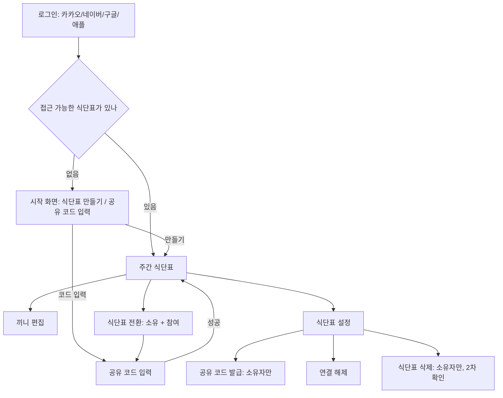

# 서버 API 없이 먼저 할 모바일 작업 계획

- 작성일: 2026-11-16
- 기준 문서: `docs/app-developer-brief.md`
- 상태: 초안 (승인 전, 코드 작업 시작 전)

## 1. 목적

서버 API가 나오기 전에 다음 두 가지를 함께 얻는다.

1. **눈에 보이는 앱**: 에뮬레이터에서 실제 화면이 움직인다.
2. **KMP에 익숙해지기**: 단계마다 KMP 개념을 하나씩 처음 만나고, 짧은 설명을 들은 뒤 진행한다.

서버가 나오면 **가짜 데이터만 진짜 API로 바꿔 끼우면** 되도록 만든다.

## 2. 이미 정한 것

| 항목 | 결정 | 정한 사람 |
|---|---|---|
| 한 주의 시작 요일 | 월요일 | 사용자 |
| 공유 코드 대소문자 | 구분 안 함 (입력을 대문자로 바꿔서 검사) | 사용자 |
| 끼니 텍스트 최대 길이 | 50자. 상수 하나로 두어 바꾸기 쉽게 함 | Claude (사용자가 맡김) |
| 라이브러리 선택 | 아래 표 | Claude (사용자가 맡김) |

### 라이브러리

| 용도 | 라이브러리 | 이유 |
|---|---|---|
| 화면 이동 | JetBrains `navigation-compose` + `kotlinx-serialization` | Android 공식 내비게이션의 KMP판이라 자료가 가장 많다. 화면 경로를 Kotlin 타입으로 정의하려면 serialization이 필요하다 |
| 화면 상태 | `ViewModel` + `StateFlow` | `lifecycle-viewmodel-compose`가 이미 들어 있다 |
| 날짜 계산 | `kotlinx-datetime` | "이번 주 월요일~일요일"을 `commonMain`에서 계산한다 |
| 테스트 | `kotlin.test` (있음) + `kotlinx-coroutines-test` | ViewModel 테스트에 필요하다 |

**넣지 않는 것**
- 의존성 주입 도구(Koin 등): 처음에는 객체를 손으로 연결하는 편이 구조를 이해하기 쉽다.
- 네트워크(Ktor): 서버가 나온 뒤에 넣는다.

버전은 각 단계에서 의존성을 추가할 때 현재 Kotlin 2.4 / Compose Multiplatform 1.12와 맞는 것으로 고른다.

## 3. 임시로 둔 것 (기획 확인 필요)

기획 문서 9장 항목 가운데 이번 작업에 걸리지만 아직 답이 없는 것이다. 모두 임시 값으로 두고, 바꿀 곳을 한 군데로 모은다.

| 항목 | 임시 처리 |
|---|---|
| 주 계산의 시간대 기준 | 기기 시간대 기준으로 "오늘"과 "이번 주"를 계산한다 |
| 식단표 이름/속성 | 이름 없음. 목록에서는 "내 식단표", "참여 중인 식단표"로 표시한다 |
| 닉네임/프로필 | 쓰지 않는다 |
| 접근이 끊긴 식단표의 응답 형태 | 가짜 저장소가 "접근 불가" 에러를 돌려주는 것으로 흉내 낸다 |
| 동시 편집 충돌, 오프라인 | 다루지 않는다 |

## 4. 지금 하지 않는 것

- 실제 서버 연동, 토큰 저장, 토큰 갱신
- 실제 간편 로그인 SDK 연동 (제공자 앱 등록과 키 관리 담당이 정해지지 않음)
- 회원 탈퇴, 계정 연결 (기획 미정)
- 푸시 알림
- iOS 빌드와 실행 확인 (Windows 환경). iOS용 코드는 쓰되 컴파일 확인은 macOS에서 따로 해야 한다.

## 5. 단계별 계획

모든 단계에 다음 세 가지를 적는다.
- **결과물**: 단계가 끝나면 손에 쥐는 것
- **새 KMP 개념**: 이 단계에서 처음 만나는 개념
- **확인 방법**: 끝났는지 확인하는 방법 (PowerShell 기준)

한 단계가 끝날 때마다 커밋한다.

### 0단계. 화면 흐름 설계 (코드 없음)

- **결과물**: `docs/screen-flow.md`. 화면 목록, 화면 사이의 이동, 화면마다 처리할 에러 상황을 적는다.
- **새 KMP 개념**: 없음
- **확인 방법**: 사용자가 문서를 읽고 승인한다.

초안 흐름:

### 1단계. 템플릿 정리와 화면 이동 뼈대

- **결과물**: 0단계의 화면들이 제목만 있는 빈 화면으로 존재하고, 버튼으로 서로 이동할 수 있다. 템플릿의 Greeting 예제는 지운다.
- **새 KMP 개념**: `commonMain`에 Compose UI를 두는 구조, `libs.versions.toml`로 의존성 추가, 공통 내비게이션
- **확인 방법**: `.\gradlew.bat :androidApp:assembleDebug` 성공. 에뮬레이터에서 화면 이동을 확인한다.

### 2단계. 도메인 모델과 주 계산 (TDD)

- **결과물**: `commonMain`에 식단 관련 기본 타입을 둔다.
  - 끼니 종류: 아침, 점심, 저녁
  - 하루 식단, 한 주 식단 (7일 × 3끼)
  - 주를 나타내는 값: 월요일 시작. 이전 주와 다음 주로 이동할 수 있다.
  - 끼니 텍스트 검증: 최대 50자
- **새 KMP 개념**: `commonTest`, 테스트를 먼저 쓰는 방식, `kotlinx-datetime`
- **확인 방법**: `.\gradlew.bat :shared:testAndroidHostTest` 통과. 다음 경우를 테스트한다.
  - 일요일이 그 주의 마지막 날로 계산된다.
  - 연말과 연초에 걸친 주가 올바르게 계산된다.
  - 50자와 51자 경계에서 검증 결과가 갈린다.
  - 빈 주는 21칸 모두 비어 있다.

### 3단계. 가짜 저장소와 주간 식단표 화면

- **결과물**:
  - 식단 저장소 인터페이스. 서버가 나오면 진짜 구현으로 바꿀 자리다.
  - 메모리에만 데이터를 두는 가짜 구현. 앱을 끄면 데이터가 사라진다.
  - 주간 식단표 화면: 7일 × 3끼 표, 이전 주와 다음 주 이동, 빈 주 표시
  - 끼니를 눌러 메뉴를 입력, 수정, 삭제하는 기능. 50자를 넘으면 입력을 막고 안내한다.
  - 식단표 전환 화면: 가짜 데이터로 "내 식단표"와 "참여 중인 식단표"를 오간다.
- **새 KMP 개념**: `ViewModel`과 `StateFlow`, 인터페이스로 가짜와 진짜를 바꿔 끼우는 구조, 코루틴 기초
- **확인 방법**:
  - ViewModel 테스트 통과: 주 이동, 끼니 저장 후 화면 상태 반영, 빈 주
  - 에뮬레이터에서 끼니를 입력하고 다른 주로 갔다 돌아와도 값이 남아 있다.

### 4단계. 공유 코드 입력 형식 검증 (TDD)과 입력 화면

- **결과물**:
  - 앱에서 먼저 하는 형식 검사. 최종 판단은 서버가 한다.
    - 앞뒤 공백은 지운다 (Claude가 정함).
    - 대문자로 바꾼다 (대소문자 구분 안 함).
    - 8자리여야 한다.
    - 영문 대문자와 숫자만 허용한다. `0`, `O`, `1`, `I`는 허용하지 않는다.
  - 공유 코드 입력 화면. 형식이 틀리면 서버에 보내기 전에 바로 안내한다.
  - 가짜 저장소가 서버 에러를 흉내 내고, 화면이 에러마다 다른 안내를 보여 준다.
    - 만료됨, 이미 사용됨, 이미 동반자가 있음, 본인 코드
    - 시도 제한으로 15분 차단됨 (남은 시도 횟수 표시 포함)
  - 소유자의 공유 코드 발급 화면 (가짜 코드, 유효 시간 3시간 표시)
- **새 KMP 개념**: 결과를 `sealed class`로 표현하는 방식, 순수 로직을 `commonTest`에서 빠르게 테스트하기
- **확인 방법**: 다음 경우를 테스트하고 통과한다.
  - 소문자 입력이 통과한다.
  - 앞뒤 공백이 있는 입력이 통과한다.
  - 7자리와 9자리는 실패한다.
  - `0`, `O`, `1`, `I`, 특수문자, 한글이 들어가면 실패한다.
  - 소문자 `o`와 `i`는 대문자로 바뀐 뒤 실패한다.

### 5단계. 간편 로그인 `expect`/`actual` 뼈대

- **결과물**:
  - `commonMain`:
    - 로그인 제공자 종류: 카카오, 네이버, 구글, 애플
    - 로그인 결과: 성공(제공자 토큰), 사용자가 취소, 실패
    - 로그인을 요청하는 `expect` 선언
  - `androidMain`과 `iosMain`의 `actual` 구현은 가짜다. 잠깐 기다린 뒤 가짜 토큰을 돌려준다.
  - Android 애플 로그인은 웹 로그인 방식이 될 자리라고 주석으로 표시한다.
  - 로그인 화면: 버튼 4개. 성공하면 시작 화면으로 가고, 취소하거나 실패하면 안내를 보여 준다.
- **새 KMP 개념**: `expect`/`actual`, 플랫폼별 소스 세트(`androidMain`, `iosMain`)
- **확인 방법**:
  - Android 빌드 성공
  - 에뮬레이터에서 로그인부터 시작 화면, 주간 식단표까지 처음부터 끝까지 이동한다.
  - iOS 쪽 `actual`은 Windows에서 컴파일 확인을 할 수 없다. 나중에 macOS에서 확인할 항목으로 남긴다.

## 6. 서버가 나오면 바꿀 곳

- 3단계와 4단계의 가짜 저장소를 Ktor로 구현한 진짜 저장소로 바꾼다.
- 5단계의 가짜 `actual`을 각 제공자 SDK로 바꾸고, 서버에서 받은 토큰을 저장한다.
- 3장의 임시 값을 기획 답변에 맞춰 고친다.
