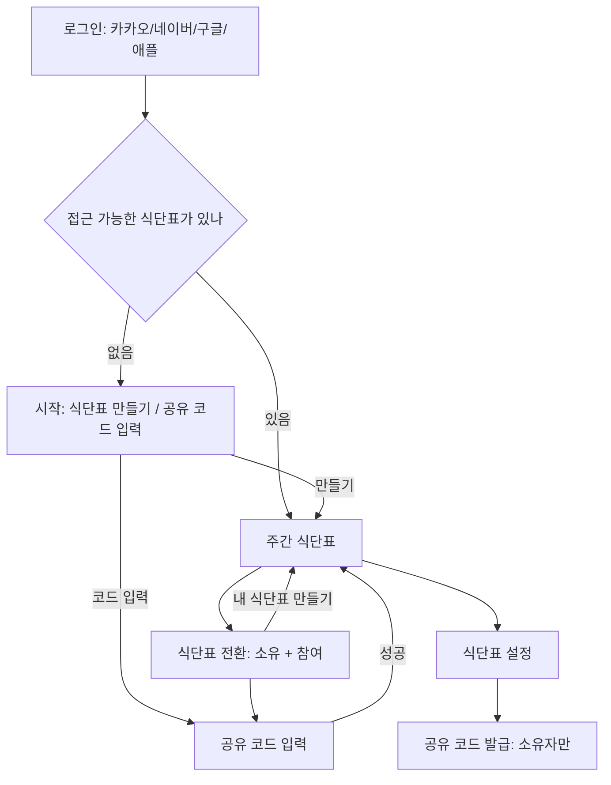

# 화면 흐름

- 작성일: 2026-11-16
- 기준 문서: `docs/app-developer-brief.md`, `docs/plan.md`
- 상태: 승인 (2026-11-16)

## 1. 흐름도

## 2. 화면 목록

| 화면 | 경로 타입 | 진입 방법 | 다루는 에러 (기획 5장) |
|---|---|---|---|
| 로그인 | `LoginRoute` | 앱 시작 | 사용자 취소, 토큰 검증 실패, 네트워크/제공자 오류 |
| 시작 (식단표 없음) | `StartRoute` | 로그인 후 접근 가능한 식단표가 없을 때 | 없음 |
| 주간 식단표 | `WeeklyRoute` | 만들기, 코드 입력 성공, 로그인 후 식단표가 있을 때 | 접근 상실 (연결 해제/삭제됨) |
| 공유 코드 입력 | `CodeInputRoute` | 시작 화면, 식단표 전환 화면 | 형식 오류, 만료, 이미 사용됨, 이미 동반자 있음, 본인 코드, 15분 차단 |
| 식단표 전환 | `PlanSwitchRoute` | 주간 식단표 | 없음 |
| 식단표 설정 | `PlanSettingsRoute` | 주간 식단표 | 권한 없음 (동반자가 발급/삭제 시도) |
| 공유 코드 발급 | `IssueCodeRoute` | 식단표 설정 (소유자만 보임) | 권한 없음 |

## 3. 대화상자 (화면이 아닌 것)

| 대화상자 | 어디 위에 뜨나 | 내용 |
|---|---|---|
| 끼니 편집 | 주간 식단표 | 메뉴 입력/수정/삭제, 50자 제한 안내 |
| 연결 해제 확인 | 식단표 설정 | 소유자: 동반자 해제 / 동반자: 식단표에서 나가기 |
| 식단표 삭제 2차 확인 | 식단표 설정 | 영구 삭제되고 복구할 수 없다는 안내 (기획 4.2) |

## 4. 소유자와 동반자에게 보이는 차이

| 화면 | 소유자 | 동반자 |
|---|---|---|
| 주간 식단표 | 같음 (편집 권한 동일) | 같음 |
| 식단표 전환 | 소유한 식단표와 참여 중인 식단표가 모두 보인다 | 같음 |
| 식단표 설정 | 공유 코드 발급, 동반자 연결 해제(동반자가 있을 때만), 식단표 삭제 | 식단표에서 나가기 |

식단표 전환 화면에는 공유 코드 입력 버튼이 있다. 소유한 식단표가 없는 사용자(동반자로만 참여 중)에게는 "내 식단표 만들기" 버튼도 보인다.

## 5. 끝난 뒤 이동

| 상황 | 이동 |
|---|---|
| 로그인 성공 | 접근 가능한 식단표가 있으면 주간 식단표, 없으면 시작. 뒤로 가기로 로그인에 돌아가지 않는다 |
| 식단표 만들기, 공유 코드 입력 성공 | 그 식단표의 주간 식단표. 이전 화면은 백스택에서 지운다 |
| 식단표 삭제, 연결 해제(동반자가 나감) | 남은 식단표가 있으면 그 주간 식단표, 없으면 시작 |
| 접근 상실 에러 | "더 이상 볼 수 없는 식단표" 안내 뒤 위와 같이 이동 |

## 6. 확인 필요

- 이미 동반자가 있는 식단표에서 소유자가 공유 코드를 발급할 수 있는가. (서버 확인 필요) 기획에는 "이미 동반자가 있는 식단표"에 코드를 입력하면 에러라는 규칙만 있다. 임시 결정(사용자 승인): 동반자가 있으면 발급 버튼을 숨긴다.
